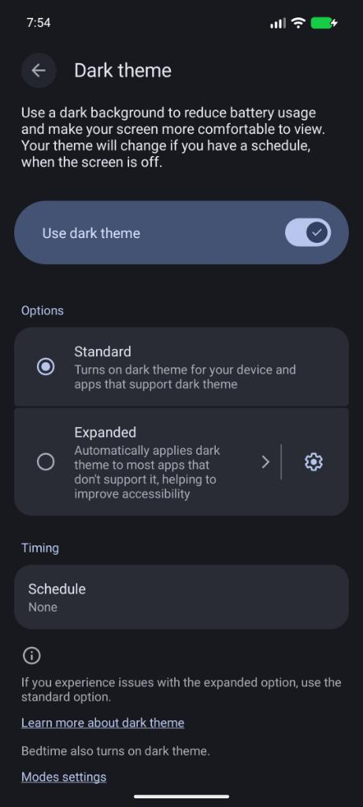

# burner-mcp

A virtual Android phone that Claude can drive: tap, type, swipe, read the screen, open apps. It runs headless on an
Arch-based Linux machine, and you can watch it live with scrcpy. **burner-mcp** is a slim MCP server in front of
[mobile-mcp](https://github.com/mobile-next/mobile-mcp) that keeps each step cheap in tokens.

Think of it as a burner phone for Claude: a real Android 17 phone with Google Play that you can reset to a clean
state in about 3 seconds.

```
Host (Arch-based Linux)
  Android emulator  ← adb →  mobile-mcp  ← stdio →  burner-mcp (127.0.0.1:8790, bearer token)
  (systemd user service)                              │
                          local (default) ────────────┴── Claude Code on this machine
                                                           (from your phone: Remote Control or SSH)
                          --public (optional) ──────────── Tailscale Funnel → claude.ai custom connector
                                                           (web, desktop, mobile apps)
```



## Set up

```bash
git clone https://github.com/sean-imus/burner-mcp
cd burner-mcp
./install.sh
```

It asks for your sudo password (packages) and `y` to the Android SDK license. Then it creates the phone, sets up the
phone and the server as systemd user services, and prints the `claude mcp add …` command that connects Claude Code to
it. To use the phone from your actual phone, open that Claude Code session with **Remote Control** from the Claude app.

**Public mode** (`./install.sh --public`) also publishes the server at `https://<host>.<tailnet>.ts.net/mcp` through
Tailscale Funnel. You add it once as a claude.ai custom connector (header `Authorization` = `Bearer <token>`), and
then it works in every Claude app without Claude Code. The cost: a public URL protected by one token (see Security).

**Requirements:** an Arch-based distro (Arch, Omarchy, EndeavourOS, Manjaro, …), x86_64 with KVM, about 8 GB free
RAM and about 15 GB of disk. Re-running the installer in the **same mode** is the update path. `./uninstall.sh`
removes the services (`--purge` also deletes the SDK and the phone).

## The tools

| Tool | What it does |
|---|---|
| `screen` | Foreground app plus the labelled elements, with refs and tap coordinates. `image=true` adds a screenshot |
| `tap` | By visible text (`"Wi-Fi"`), by ref (`"@e12.3"`), or at `"x,y"`. `long=true` long-presses |
| `type` | Types into the focused field, or into `into` first. `clear=true` replaces the text, `submit=true` presses Enter |
| `swipe` | Scrolls by `direction`, or drags exactly `from`→`to` over `ms` (games, maps, sliders) |
| `press` | BACK, HOME, RECENTS, ENTER, BACKSPACE, VOLUME_UP/DOWN, POWER. `times=N` repeats |
| `open` | An app by name or package, or an https URL |
| `reset` | Restores the clean snapshot (~3 s) |

Every action returns the updated screen, so Claude doesn't need a separate "look" call. Every action also accepts
`image=true`, for apps whose UI isn't exposed as text.

**Why a wrapper instead of plain mobile-mcp?** Tokens:

| | mobile-mcp directly | burner-mcp |
|---|---|---|
| Tool definitions | 33 tools, 29k chars (~7k tokens) | 7 tools, 3.7k chars (~0.9k tokens) |
| Reading the home screen | 7.5k chars (~2k tokens) | 0.5k chars (~140 tokens) |
| Act + look | 2 calls | 1 call |

It also carries its own usage instructions, so it works in every Claude app without a skill. It serializes access
when several Claudes use the phone at once, and it turns off mobile-mcp's telemetry.

In a real-model eval of 8 phone tasks, Haiku with burner-mcp passed **8/8 with half the turns and 4.6× fewer input
tokens** than Haiku with plain mobile-mcp (7/8). Details and robustness results are in [TESTING.md](TESTING.md).

## Repo map

| Path | What |
|---|---|
| [`install.sh`](install.sh), [`uninstall.sh`](uninstall.sh) | Setup (`--public` for Funnel) and removal |
| [`server/`](server/) | The server (`index.mjs`), clients (`call.mjs` for burner-mcp, `mobile-call.mjs` for raw mobile-mcp), tests (`test.mjs`, `robustness.mjs`) |
| [`eval/`](eval/) | Real-model task eval (`run.mjs`, `tasks.mjs`) |
| [`systemd/`](systemd/) | Unit templates for the emulator and the server |
| [`bin/`](bin/) | `emu-start`, `emu-stop`, `emu-view`, `emu-reset`, plus `emu-run`/`emu-wait-boot` used by the service |
| [`HOW_TO_START.md`](HOW_TO_START.md) | Daily use, settings, watching the phone, troubleshooting |
| [`TESTING.md`](TESTING.md) | How to test, results, known issues |
| [`CLAUDE.md`](CLAUDE.md) | Notes for Claude Code sessions working on this repo |

## Security

In the default local mode, burner-mcp only listens on `127.0.0.1`, so nothing is exposed.

In public mode the URL is reachable from the internet, and the token is the only lock. Anyone with both can drive the phone.
- If you sign your real accounts into the phone, stay in local mode.
- In public mode, treat the phone as a device strangers could see. That's the burner idea.
- Rotate the token by editing `~/.config/burner-mcp/env`, running `systemctl --user restart burner-mcp`, and updating
  the connector (or the `claude mcp add` registration).
- To take it offline: `sudo tailscale funnel --https=443 off`. A local-mode install warns if Funnel is still on.

## Lessons learned

- Emulator 37.2 won't start unless the SDK root contains `platform-tools/`, even if you use the system adb.
- `-gpu auto` falls back to software rendering on some Intel GPUs (Iris Xe: 17 fps). `-gpu host` gives 60 fps.
- With animations on, Claude reads the UI mid-transition and sees half-empty screens. They're off by default.
- mobile-mcp refs (`@e70`) are re-resolved against the screen at tap time, so they go stale after any change.
- Tapping a search bar often opens a new screen. Typing before its field has focus loses the keys, so `type` waits for focus.
- Apps draw buttons under the 3-button navigation bar. Tapping their center presses Home, so burner-mcp taps the visible part.
- Models send several tool calls at once. Positional refs then go stale between calls, so burner-mcp ties each ref to
  the screen it came from (`@e42.7`) and refuses it if that element has moved.
- Loading a snapshot closes scrcpy, so `emu-reset` reopens it.
- claude.ai connectors call your server **from Anthropic's cloud**, so a tailnet-only address won't work. Funnel will.

## License

[MIT](LICENSE)
